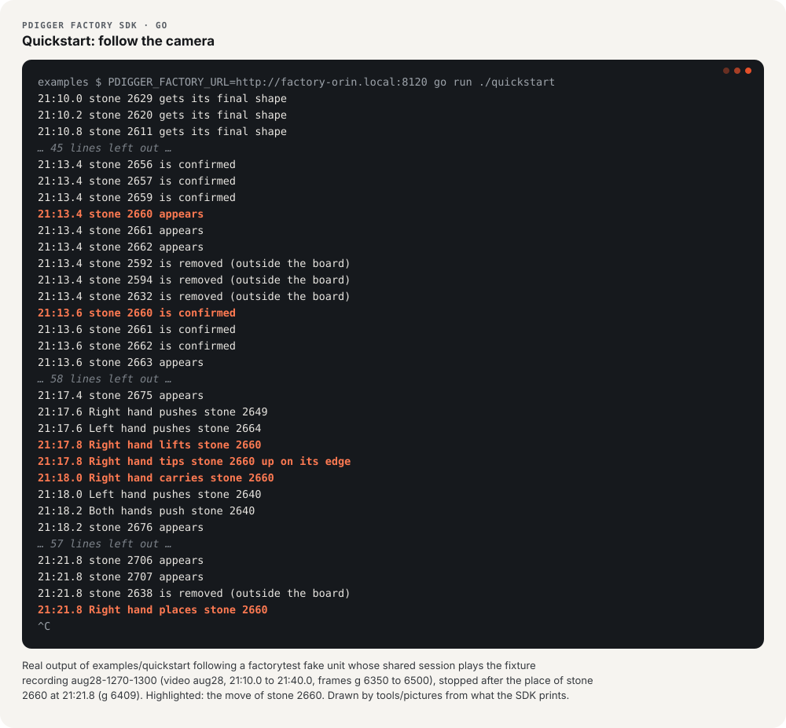
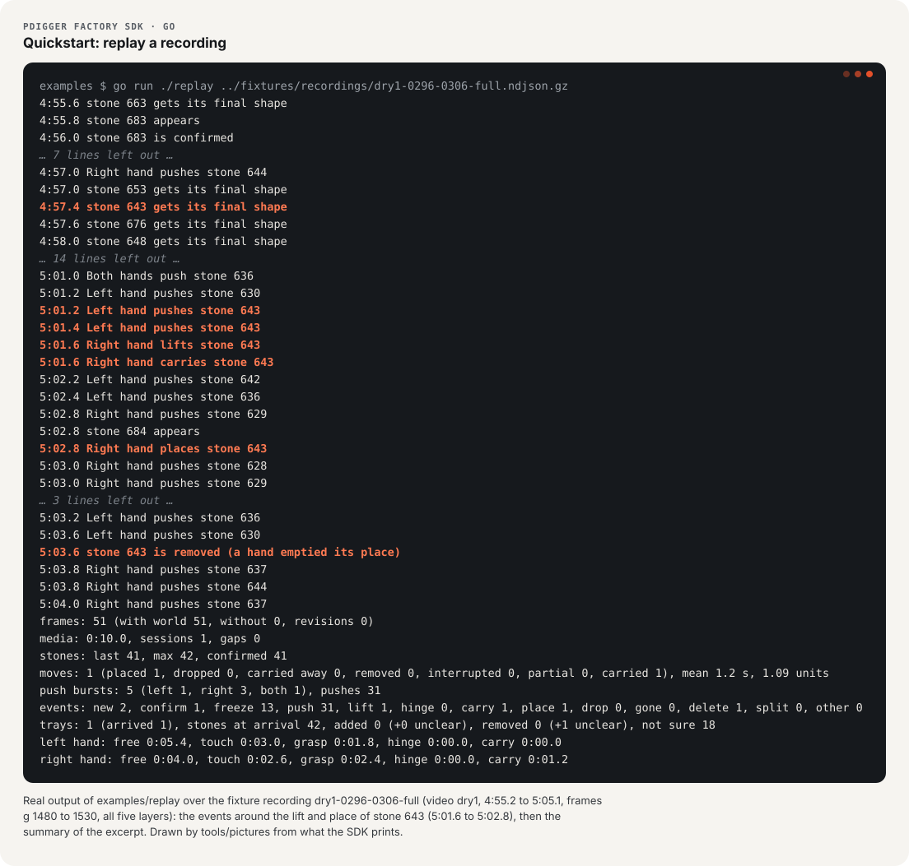

# pDigger Factory SDK for Go

[](https://github.com/eprojac/pdigger-factory-sdk-go/actions/workflows/ci.yml)
[](https://pkg.go.dev/github.com/eprojac/pdigger-factory-sdk-go)

A pDigger Factory unit watches a work area through one camera and interprets what it sees: which hand moved which stone,
when, and where the stone went. This SDK reads that record from the unit's API (v2) in Go, in two modes, live from a
unit or offline from a recording. Simple mode is one report per tray: which stones were taken off, which were put on and
which moved, when and where on the tray, and whether that is the tray's whole account. Advanced mode is the detail
underneath, for research and for correcting a report that is not complete: plain sentences such as `21:17.8 Right hand
lifts stone 2660`, every tray fact with its reason, down to every model output. It is our SDK in Go, one of its four
languages (Go, Python, Rust, TypeScript), which follow the same contract and print the same text for the same data.

- **Try the API in your browser:** https://factory.pdigger.com/developers/api/ (Swagger UI with a demo server that
  answers from real recordings)
- **Download the recordings:** https://factory.pdigger.com/developers/data/ (four complete recordings, every frame
  interpreted, with their summaries: dry1 on the 20.20 test unit, dry2, aug28 and jul30 in a replay of the same model
  and build on a Mac)
- **How the unit behaves**, measured, and what the live camera changes: [docs/BEHAVIOUR-20.20.md](docs/BEHAVIOUR-20.20.md)


## Install

```sh
go get github.com/eprojac/pdigger-factory-sdk-go@main
```

Go 1.23 or later (the streams are range-over-func iterators); the SDK uses the standard library only. The package
name is `pdiggerfactory`. Until the first release is tagged the SDK comes from the repository's main branch; from then
on, take a release: `go get github.com/eprojac/pdigger-factory-sdk-go@v0.1.0`.

New to the SDK? [The tutorials](docs/tutorials/README.md) take you from one report per tray to a frame drawn by hand,
every step a program the tests run.

## Simple mode: one report per tray

```go
// Command quickstartreports is simple mode: one report per tray, which stones were removed, which were added and
// which moved, when and where on the tray, and whether that is the tray's whole account. A recording needs no unit;
// with -follow the same report comes from a unit as each tray leaves.
//
//	go run ./quickstartreports ../fixtures/recordings/dry1-0018-0153.ndjson.gz
//	PDIGGER_FACTORY_URL=http://factory-orin.local:8120 go run ./quickstartreports -follow
package main

import (
	"context"
	"fmt"
	"log"
	"os"
	"os/signal"

	pdiggerfactory "github.com/eprojac/pdigger-factory-sdk-go"
)

func main() {
	ctx, stop := signal.NotifyContext(context.Background(), os.Interrupt) // Ctrl-C ends the loop
	defer stop()
	source := "../fixtures/recordings/dry1-0018-0153.ndjson.gz"
	if len(os.Args) > 1 {
		source = os.Args[1] // a path, an http(s) URL such as a published recording, or -follow
	}
	if source != "-follow" {
		replay, err := pdiggerfactory.OpenReplay(ctx, source, nil)
		if err != nil {
			log.Fatal(err)
		}
		defer replay.Close()
		reports, err := replay.TrayReports(ctx)
		if err != nil {
			log.Fatal(err)
		}
		for _, report := range reports {
			fmt.Println(report.Describe())
		}
		return
	}
	client, err := pdiggerfactory.New(os.Getenv("PDIGGER_FACTORY_URL")) // e.g. http://factory-orin.local:8120
	if err != nil {
		log.Fatal(err)
	}
	for report, err := range client.Interpreter().TrayReports(ctx) { // one as each tray leaves
		if err != nil {
			log.Print(err) // a frame that did not decode (the stream goes on) or the error that ended it
			continue
		}
		fmt.Println(report.Describe()) // json.Marshal(report) is the same as data
	}
}
```

A recording needs no unit; with `-follow` the same report comes from the unit at `PDIGGER_FACTORY_URL` as each tray
leaves. The report of the tray in the fixture recording `dry1-0018-0153` (dry1 from 0:18 to 2:33), real output of
`cd examples && go run ./quickstartreports ../fixtures/recordings/dry1-0018-0153.ndjson.gz`:

```text
tray 1 (2026-11-22T02:38:47.0Z), 0:22.5 to 2:24.0: 11 removed, 13 added, 8 moved, not complete: 18 unclear, 1 not sure
  0:45.5 removed 20261122T023847.0Z-1-117 from (0.68, -1.06) (0.98)
  0:45.5 removed 20261122T023847.0Z-1-127 from (1.14, -1.24) (0.98)
  0:59.4 removed 20261122T023847.0Z-1-126 from (0.35, -1.29) (0.98)
  1:05.4 removed 20261122T023847.0Z-1-105 from (0.49, -0.82) (0.98)
  1:23.6 removed 20261122T023847.0Z-1-112 from (-0.11, -0.84) (0.98)
  1:23.6 removed 20261122T023847.0Z-1-125 from (-0.09, -1.26) (0.98)
  2:24.0 removed 20261122T023847.0Z-1-87 from (0.02, -0.17) (unclear, 0.71)
  2:24.0 removed 20261122T023847.0Z-1-121 from (0.33, -1.27) (unclear, 0.71)
  2:24.0 removed 20261122T023847.0Z-1-128 from (0.56, -1.29) (unclear, 0.71)
  2:24.0 removed 20261122T023847.0Z-1-129 from (0.74, -1.29) (unclear, 0.71)
  2:24.0 removed 20261122T023847.0Z-1-130 from (0.87, -1.27) (unclear, 0.71)
  2:24.0 added 20261122T023943.4Z-1-151 at (0.16, -1.26) (unclear, 0.52)
  2:24.0 added 20261122T024104.0Z-1-177 at (0.02, -0.82) (unclear, 0.96)
```

These are its first fourteen lines; eleven more additions and its eight moves follow. The number that ends each change
is its confidence: how likely it is to be right, from how often changes of its kind were right on 150 trays of the four
complete recordings checked against their video. The unit's speckle check of each tray, part of every report, sets it
([docs/interpreter.md](docs/interpreter.md#confidence)). Keep the changes at or above a threshold of your own: at 0.90
this tray keeps its six certain removals and nine of its thirteen additions, all fifteen right by the camera check.
Below it are the other two stones that left (87 and 129), a stone the worker set down (278), three removals of stones
that stayed (121, 128 and 130) and three additions of stones that came in on the tray (151, 246 and 249).

The camera check is the maintainers' offline test (not published) that matches each stone's speckle in the recording's
video, the tray as it arrived against the tray as it left. The worker pushed most of the other stones while squaring the
rows up: the world lost some of them and saw them again under new ids, and the speckle check finds them again as the
tray leaves, so only one stone is still not sure (98, next to a pushed stone). A hand can also take a stone away and set
another one down in its place, so the SDK links a lost stone to a new world id only with evidence that it is the same
stone (the speckle check, their looks, or no hand near either); without it, the lost stone is removed and the new one
added, both unclear, and the stone's id never goes to another stone. Of the thirteen unclear additions, ten are stones
the worker set down and three came in on the tray. Each change gives scene coordinates. A removal gives its last
observed place. An added stone gives its place as the tray left: where it was seen at the leaving point, else where it
was last seen. A stone counted only because the world kept it at the leaving point without a box gives its place in that
world. A stone is reported moved only when the SDK is sure it is the same stone. `not complete` says what is left open:
18 unclear changes and 1 other retained stone with an uncertain identity. Complete means complete as far as the world
sees. A stone the model stops seeing for good while it stays on the tray is removed: for certain when a hand touched it
just before, else unclear (3 of the 52 certain removals in a camera check of the four complete recordings, each one a
stone a hand had moved). A box seen on an empty slot at the arrival becomes a tray stone. A stone the world does not
have as the tray leaves is not in the account. Nor is one it keeps there without a box while a hand holds it, or with
30 % or more of its box under the box of a stone no hand holds (none here: the camera counts 44 stones as the tray
leaves, and so does the account, with world 281, which a hand set down six seconds before and the world kept although
the model had not boxed it yet) ([docs/interpreter.md](docs/interpreter.md#trays-and-tray-stones)). Advanced mode says
that stone by stone ([the first tutorial](docs/tutorials/00-start-here.md) shows how).

## Advanced mode: follow the unit

This program follows the unit's shared session and prints each event as a sentence until you press Ctrl-C, whatever
the session shows: a recording, or one of the plant cameras live (the 20.20 unit lists six;
[Live cameras](#live-cameras-and-the-shared-session) shows how to select one and wait out its warm-up). The program is
the same in both cases.

```go
package main

import (
	"context"
	"fmt"
	"log"
	"os"
	"os/signal"

	pdiggerfactory "github.com/eprojac/pdigger-factory-sdk-go"
)

func main() {
	ctx, stop := signal.NotifyContext(context.Background(), os.Interrupt) // Ctrl-C ends the loop
	defer stop()
	client, err := pdiggerfactory.New(os.Getenv("PDIGGER_FACTORY_URL")) // e.g. http://factory-orin.local:8120
	if err != nil {
		log.Fatal(err)
	}
	for event, err := range client.Interpreter().Events(ctx) {
		if err != nil {
			log.Print(err) // a frame that did not decode (the stream goes on) or the error that ended it
			continue
		}
		fmt.Println(event.Describe()) // 21:17.8 Right hand lifts stone 2660
	}
}
```

```sh
cd examples && PDIGGER_FACTORY_URL=http://factory-orin.local:8120 go run ./quickstart
```



*The real output of `examples/quickstart` against the SDK's fake unit (`factorytest`) playing the fixture recording
aug28-1270-1300 (video aug28, 21:10.0 to 21:40.0, frames g 6350 to 6500, from the replay of the 20.20 unit's model and
build on a Mac), stopped after the place of stone 2660 at 21:21.8 (g 6409). Drawn by [tools/pictures](tools/pictures) from what the SDK prints.*

No unit? `make fake-unit` in the repository root serves that fake unit on http://127.0.0.1:8120 with the same
recording; then, in `examples/`, run `PDIGGER_FACTORY_URL=http://127.0.0.1:8120 go run ./quickstart`.

## Advanced mode: replay a recording

The same interpreter runs offline over a recording file: one of the published recordings (read as a stream, never
loaded whole) or a local file. No unit is needed.

```go
func main() {
	source := "https://factory.pdigger.com/developers/data/dry1.world.ndjson.gz"
	if len(os.Args) > 1 {
		source = os.Args[1]
	}
	ctx := context.Background()
	replay, err := pdiggerfactory.OpenReplay(ctx, source, nil)
	if err != nil {
		log.Fatal(err)
	}
	defer replay.Close()
	result, err := replay.Run(ctx) // one pass: events, activities and the summary
	if err != nil {
		log.Fatal(err)
	}
	for _, event := range result.Events {
		fmt.Println(event.Describe()) // 5:02.8 Right hand places stone 643
	}
	fmt.Print(result.Summary.Describe())
}
```



*The real output of `examples/replay` over the fixture recording dry1-0296-0306-full (video dry1, 4:55.2 to 5:05.1,
frames g 1480 to 1530, all five layers). The same recording gives the same text, byte for byte, in all four languages.*

## Advanced mode, in three layers

Under the reports, the detail comes in three layers. Each is built on the one below it, and you can use any of them
directly.

| Level | What | Where |
|---|---|---|
| High | `Interpreter`: events, activities (moves, push bursts), hand states, the stone inventory, per-stone tracks, trays with stone ids never reused and facts never revised, the summary, sentences, `WaitFor`. `Replay`: the same over a recording. The shared session's sources, controls and clock | `client.Interpreter()`, `OpenReplay`, `client.Session()`, `client.Sources()`, `client.Live()` |
| Mid | Frame streams that resume by themselves and backfill late layers; the long-poll; raw packets; render-ready 2-D and 3-D draw lists | `client.Streams()`, `client.API().RenderOverlay2D`, `RenderScene3D` |
| Low | One method per API operation (32), typed models for every schema, one error type, retries; the `codec` package | `client.API()`, package `codec` |

### High level: the interpreter

Wait for something to happen, then follow it. A later loop over the same `Interpreter` goes on where the last one
stopped, first with the rest of that frame (what the last loop did not yield), so nothing is missed in between.

```go
func follow(ctx context.Context, client *pdiggerfactory.Client) error {
	interpreter := client.Interpreter()
	isLift := func(e pdiggerfactory.Event) bool { return e.Type == pdiggerfactory.EventLift && e.StoneID != nil }
	lift, err := interpreter.WaitFor(ctx, isLift, 10*time.Minute)
	if err != nil {
		return err
	}
	fmt.Println("lift: ", lift.Describe())
	stone := *lift.StoneID
	for update, err := range interpreter.Updates(ctx) { // goes on with the rest of the lift's frame
		if err != nil {
			return err
		}
		for _, event := range update.Events {
			if event.StoneID != nil && *event.StoneID == stone {
				fmt.Println("event:", event.Describe())
			}
		}
		for _, activity := range update.Activities {
			if activity.Kind == pdiggerfactory.KindMove && activity.StoneID != nil && *activity.StoneID == stone {
				fmt.Println("move: ", activity.Describe(), "->", activity.Outcome)
				hands := update.State.Hands
				fmt.Printf("hands: left %s, right %s\n", hands.Left.State, hands.Right.State)
				fmt.Print(interpreter.Summary().Describe())
				return nil
			}
		}
	}
	return ctx.Err()
}
```

On the fixture recording aug28-1270-1300 this prints `lift:  21:17.8 Right hand lifts stone 2660`, then
`event: 21:17.8 Right hand tips stone 2660 up on its edge` (the rest of the lift's frame), `event: 21:18.0 Right hand
carries stone 2660`, `event: 21:21.8 Right hand places stone 2660` and `move:  21:17.8 Right hand moves stone 2660 0.84
units in 4.0 s -> placed`.
Distances are in units of the template gauge (the scale of a template adult), not metres. More in
[docs/interpreter.md](docs/interpreter.md).

### Trays: ids never reused, facts never revised

The world's stone ids are the engine tracker's: it renames a stone it lost and found again, and it can give a stone's id
to another one (a stone set down where a removed one lay, a row of equal stones pushed one place along). For anything
that must hold over time, use the tray stones. The interpreter follows each tray from the moment it has arrived and
settled to the moment it is about to move out, and gives every stone on it an id that is never reused, no other tray
stone is ever given it (`20261122T023847.0Z-1-117`: first seen at that UTC time, on tray 1, under world id 117). A
tray stone says whether its identity is still sure, and a fact about it is certain or unclear:
`0:45.5 tray 1: stone 20261122T023847.0Z-1-117 was removed` is certain and is never revised, and what the rules cannot be
sure of is reported as unclear, never guessed. `replay.Trays(ctx)` lists the trays with their two points, the ones to
jump between ([examples/traypoints](examples/traypoints/main.go)):

```go
	trays, err := replay.Trays(ctx)
	if err != nil {
		log.Fatal(err)
	}
	var shown *pdiggerfactory.Tray
	for i := range trays {
		tray := &trays[i]
		arrived, leaving, ok := tray.Window()
		if !ok {
			continue // a stop that never settled
		}
		fmt.Printf("tray %d: arrived %s, leaving %s\n", tray.N, pdiggerfactory.FormatClock(arrived),
			pdiggerfactory.FormatClock(leaving))
		for _, stone := range tray.Stones {
			if stone.Status == pdiggerfactory.TrayStoneRemoved && *stone.Certain {
				fmt.Println("  removed:", stone.ID)
			}
		}
		if tray.N == show && shown == nil {
			shown = tray
		}
	}
```

Live, `interpreter.TrayFacts(ctx)` yields the same facts as frames make them, and every event names the tray stone its
world id stands for (`event.TrayStone`). On busy trays, where hands push rows of equal stones, the tray rules alone
lose track of many stones; as the tray leaves, the unit's speckle check settles most of them again (on the published
recordings 95.6 % of the stones are sure as their tray leaves where it answers), and every change carries its
confidence. Without an answer for the leaving (hands still at work after the tray's last calm frame), most of those
stones stay not sure and the stones set down are mostly reported as unclear. The SDK sees only the world: a box the
model sees on an empty slot when the tray arrives cannot be told from a stone, and a stone the model stops seeing for
good while it stays on the tray looks removed ([docs/interpreter.md](docs/interpreter.md#trays-and-tray-stones)).

### Live cameras and the shared session

The plant cameras are sources like the recordings, listed after them by their serials (`CAM00000001`):
`client.Cameras`, and `client.Live` for the first. Watching one moves the shared session for every viewer to it: the
session is `connecting` until the camera's first frame, then `warming` while the interpreter runs on its first 3
seconds of frames (none of them is shown), then `live`, and `Session().UntilLive` waits for that (the select counts as
a viewer for 15 s, so this works on a unit nobody else watches; [examples/livecamera](examples/livecamera/main.go)):

```go
	var camera *pdiggerfactory.Source
	if serial != "" {
		camera, err = client.Source(ctx, serial) // that camera
	} else {
		camera, err = client.Live(ctx) // the first camera
	}
	if err != nil {
		log.Fatal(err)
	}
	// connecting, then warming up on the camera's first 3 s
	if _, err := client.Session().Watch(ctx, camera.ID, nil); err != nil {
		log.Fatal(err)
	}
	state, err := client.Session().UntilLive(ctx, 30*time.Second)
	if err != nil {
		log.Fatal(err)
	}
	lag := 0.0
	if state.Live != nil {
		lag = state.Live.Lag
	}
	fmt.Printf("%s (%s) is live: session %d, %.2f s behind the camera\n", camera.ID, camera.Name(), state.Session, lag)

	// the JPEG the newest frame was interpreted from
	picture, err := client.Session().Picture(ctx, pdiggerfactory.LatestFrame())
	if err != nil {
		log.Fatal(err)
	}
	fmt.Printf("frame g %d: a %d-byte JPEG\n", picture.G, len(picture.JPEG))
```

Then it prints the events with their wall times, `02:38:53 UTC  0:03.7 stone 651 gets its final shape` on the fake
unit. From then on the frames, the world and the events stream as on a recording, at the camera's rate as far as the
worker keeps up (1.6 to 3.9 frames a second on build `claude-20261120-looks1`; build `claude-20261122-hr4x1` interprets
about 3.6 a second on a camera). A camera has no time: `Watch` with a time and `Seek` fail with `not_seekable`
without sending the select or the seek (a seek reads the session first, a watch of an id the catalog; the unit refuses
a select with a time with 400 and a seek with 409), `Pause` freezes the shared view, and `Play` goes back to
`connecting` and continues at the live edge after a new warm-up (`UntilLive` waits it out). A camera has no media either: every frame comes with its picture
(`Session().Picture`, with `InSession` and the frame's session to refuse a frame of a session that has ended). Events
carry a wall time from the shared state, which on a camera is the timestamp that matters.
[docs/concepts.md](docs/concepts.md#sources-and-the-live-cameras) explains the session, and
[docs/BEHAVIOUR-20.20.md](docs/BEHAVIOUR-20.20.md) gives measurements of the 20.20 unit and its live cameras.

### Mid level: streams

Frames as the unit releases them, with the session's side events. The stream reconnects with `Last-Event-ID` when the
connection drops or the server ends it, and breaking the loop closes the connection.

```go
frames := 0
stream := client.Streams().Frames(ctx, pdiggerfactory.Layers(pdiggerfactory.LayerWorld), pdiggerfactory.Observe(true))
for item, err := range stream {
	if err != nil {
		log.Print(err)
		continue
	}
	switch it := item.(type) {
	case *pdiggerfactory.FrameItem:
		frames++
		stones := 0
		if it.Frame.World != nil { // nil when the world came late (Backfill(true) waits for it)
			stones = len(it.Frame.World.Stones)
		}
		fmt.Printf("frame g %d at %s: %d stones\n", it.Frame.G, pdiggerfactory.FormatClock(it.Frame.T), stones)
	case *pdiggerfactory.ClockItem:
		fmt.Printf("clock: session %d plays %s, playing %v\n", it.State.Session, it.State.Video, it.State.Playing)
	case *pdiggerfactory.WorkerItem:
		fmt.Printf("worker: %s\n", it.Worker.State)
	case *pdiggerfactory.GapItem, *pdiggerfactory.ResetItem:
		fmt.Printf("%s: frames were skipped\n", item.Kind())
	}
	if frames == 3 {
		break // closes the connection
	}
}
```

More in [docs/streams.md](docs/streams.md).

### Low level: one method per operation

Every operation of the [OpenAPI document](spec/openapi.yaml) has a method with typed parameters and replies; the
`codec` package unpacks the encoded maps and buffers.

```go
api := client.API()
root, err := api.GetAPIRoot(ctx)
if err != nil {
	log.Fatal(err)
}
fmt.Printf("API %s, build %s\n", root.API, root.Build)

// The newest world, then the model's raw output of the same frame (the very newest frame may still be waiting
// for its world).
world, err := api.GetWorld(ctx, nil)
if err != nil {
	log.Fatal(err)
}
frame, err := api.GetFrame(ctx, pdiggerfactory.FrameAt(world.G), &pdiggerfactory.FrameParams{
	Layers: []string{pdiggerfactory.LayerRaw}})
if err != nil {
	log.Fatal(err)
}
fmt.Printf("frame g %d at %s: %d stones\n", frame.G, pdiggerfactory.FormatClock(frame.T), len(world.Stones))

// The raw layer's maps are packed: the tray map is a zlib-compressed byte grid. A frame can come without the
// layer (one listed in frame.Missing, or a fake unit playing a recording made without it).
if frame.Raw == nil || len(frame.Raw.Maps.Grid) < 2 {
	fmt.Printf("frame g %d has no raw layer, so no tray map\n", frame.G)
} else {
	maps := frame.Raw.Maps
	tray, err := codec.DecodeZlibMap(maps.Tray, int(maps.Grid[0]), int(maps.Grid[1]))
	if err != nil {
		log.Fatal(err)
	}
	cells := 0
	for _, v := range tray.Data {
		if v > 127 {
			cells++
		}
	}
	fmt.Printf("tray map %dx%d: %d of %d cells are tray\n", tray.Rows, tray.Cols, cells, len(tray.Data))
}
```

More in [docs/low-level.md](docs/low-level.md).

## Errors

Every error the SDK returns is (or wraps) one type, `*pdiggerfactory.Error`, with the HTTP status, a stable `Code` to
branch on, the server's message and the field at fault. GET requests are retried on connection errors, 429, 502, 503
and 504 before an error reaches you; a control is retried only on 429. Cancellation and deadlines come back as the
context's errors.

```go
// An API error: branch on the code, never on the message.
_, err = client.API().GetFrame(ctx, pdiggerfactory.FrameAt(1), nil)
var e *pdiggerfactory.Error
if errors.As(err, &e) {
	fmt.Printf("frame 1: HTTP %d %s (field %s)\n", e.Status, e.Code, e.Field)
	if r := e.Retained; e.Code == pdiggerfactory.CodeNotRetained && r != nil && r.G0 != nil && r.G1 != nil {
		fmt.Printf("the unit holds frames %d to %d of session %d\n", *r.G0, *r.G1, r.Session)
	}
}

// A control the server refuses, checked with a dry run: the shared session does not move.
_, err = client.Session().Seek(ctx, -5, pdiggerfactory.DryRun())
fmt.Println("seek to -5 s:", pdiggerfactory.AsError(err).Code, "retryable:", pdiggerfactory.IsRetryable(err))

// Deadlines and cancellation come back as the context's errors.
_, err = client.Interpreter().WaitFor(ctx, pdiggerfactory.AboutStone(999999), 20*time.Millisecond)
fmt.Println("no event about stone 999999 in time:", errors.Is(err, context.DeadlineExceeded))
```

## Async

- Every call takes a `context.Context`. Cancelling it ends the call, and for a stream (or a replay of a URL) it closes
  the HTTP connection, even while a read waits on a stalled one.
- Streams are `iter.Seq2[T, error]` iterators that you consume with `range`. Breaking the loop closes the
  connection, and the stream's reading goroutine stops with it. A stream handles dropped connections and server
  restarts itself; it yields an error for an item that does not decode and goes on, and it ends after yielding an
  error it cannot recover from (such as a 404).
- A `Client` is safe for concurrent use. An `Interpreter` should be consumed by one loop at a time; its `State` and
  `Summary` can be read from any goroutine.
- `pdiggerfactory.Chan` turns any stream into a channel for `select`-based code:

```go
// The same frames over the long-poll, as a channel: stop after three frames or five seconds.
ctx, cancel := context.WithTimeout(ctx, 5*time.Second)
defer cancel()
polled := pdiggerfactory.Chan(ctx, client.Streams().Poll(ctx, pdiggerfactory.Observe(true)))
for frames = 0; frames < 3; {
	select {
	case r, ok := <-polled:
		if !ok {
			return
		}
		if fi, isFrame := r.Value.(*pdiggerfactory.FrameItem); isFrame {
			frames++
			fmt.Printf("polled frame g %d\n", fi.Frame.G)
		}
	case <-ctx.Done():
		fmt.Println("no frame within 5 s")
		return
	}
}
```

## Testing your code

The `factorytest` package is a fake unit that answers the whole API from a recording and recorded replies. It runs
in process or on a loopback port, with fault injection, so the code you build on the SDK can be unit-tested without a
unit, a network or a real clock:

```go
func TestLifts(t *testing.T) {
	// A fake unit whose session plays the recording embedded in factorytest (aug28 from 21:10.0, one lift); the
	// client talks to it in process.
	fake, err := factorytest.New(factorytest.WithSampleRecording())
	if err != nil {
		t.Fatal(err)
	}
	client, err := pdiggerfactory.New(fake.URL(), pdiggerfactory.WithTransport(fake.Transport()),
		pdiggerfactory.WithClock(factorytest.NewClock(time.Time{})))
	if err != nil {
		t.Fatal(err)
	}
	// Faults: the first stream drops after 20 events, the next connection attempt fails with a 503.
	fake.DropAfter("streamFrames", 20)
	fake.FailNext("streamFrames", 1, factorytest.ErrorReply(503, "busy", "try again"))

	ctx, cancel := context.WithTimeout(context.Background(), 30*time.Second)
	defer cancel()
	lifts, err := Lifts(ctx, client, 1)
	if err != nil {
		t.Fatal(err)
	}
	if want := "21:17.8 Right hand lifts stone 2660"; len(lifts) != 1 || lifts[0] != want {
		t.Fatalf("got %q, want %q", lifts, want)
	}
	if ops := fake.Ops(); len(ops) < 3 {
		t.Fatalf("the stream did not resume: %v", ops)
	}
}
```

`WithSampleRecording()` plays a real recording embedded in `factorytest` (aug28, from a replay of the 20.20 unit's
model and build on a Mac); the other recordings and replies to test with are in [fixtures/](fixtures) (real data of the
unit and of that replay, redacted; each recording's header says which), which a project that requires the SDK finds
under `go list -m -f '{{.Dir}}' github.com/eprojac/pdigger-factory-sdk-go`. More in [docs/testing.md](docs/testing.md).

## Docs

- [docs/tutorials/](docs/tutorials/README.md): start here, four short tutorials (high level, low level, live cameras,
  Go), every program in them an example that the tests run
- [docs/concepts.md](docs/concepts.md): the shared session, sources and the live cameras, frames and layers, cursors,
  revisions, coordinates
- [docs/interpreter.md](docs/interpreter.md): events, activities, trays and tray stones, their sentences, the state,
  the summary
- [docs/replay.md](docs/replay.md): recordings, offline replays, trays and their points, pacing
- [docs/streams.md](docs/streams.md): frame streams, resume, backfill, revisions, the long-poll, raw packets
- [docs/low-level.md](docs/low-level.md): the 32 operations, models, errors, retries, the codec
- [docs/testing.md](docs/testing.md): the fake unit, fault injection, this SDK's own tests
- [examples/](examples): every code sample above as a program, each tested against the fake unit
- The API reference: `go doc -all github.com/eprojac/pdigger-factory-sdk-go`, or
  [pkg.go.dev](https://pkg.go.dev/github.com/eprojac/pdigger-factory-sdk-go); CI builds it as an artifact
- The contract the four languages share: [spec/SDK-DESIGN.md](spec/SDK-DESIGN.md); the API: [spec/openapi.yaml](spec/openapi.yaml)

## The other languages

| Language | Repository | Package |
|---|---|---|
| Go | [pdigger-factory-sdk-go](https://github.com/eprojac/pdigger-factory-sdk-go) | `github.com/eprojac/pdigger-factory-sdk-go` |
| Python | [pdigger-factory-sdk-python](https://github.com/eprojac/pdigger-factory-sdk-python) | `pdigger-factory-sdk` (`import pdigger_factory_sdk`), on PyPI from its first release |
| Rust | [pdigger-factory-sdk-rust](https://github.com/eprojac/pdigger-factory-sdk-rust) | crates `pdigger-factory-sdk` and `pdigger-factory-viz`, on crates.io from their first release |
| TypeScript | [pdigger-factory-sdk-ts](https://github.com/eprojac/pdigger-factory-sdk-ts) | `pdigger-factory-sdk` (`/viz`, `/testing`), on npm from its first release |

What every language has:

| | Go | Python | Rust | TypeScript |
|---|---|---|---|---|
| **High:** Interpreter (events, moves, push bursts, hands, stones, tracks, summary, text, `wait_for`) | ✓ | ✓ | ✓ | ✓ |
| **High:** Replay of a recording file or URL, with real-time pacing | ✓ | ✓ | ✓ | ✓ |
| **High:** Trays: stone ids never reused, certain and unclear facts never revised, arrival and leaving points | ✓ | ✓ | ✓ | ✓ |
| **High:** sources and the live cameras (warm-up, pictures), the shared session's controls (with `dry_run`), its clock | ✓ | ✓ | ✓ | ✓ |
| **Mid:** frame streams that resume (`Last-Event-ID`) and backfill late layers; long-poll; raw packets | ✓ | ✓ | ✓ | ✓ |
| **Mid:** render-ready overlay2d and scene3d draw lists, typed | ✓ | ✓ | ✓ | ✓ |
| **Low:** one method per API operation (32), typed models and errors, retries | ✓ | ✓ | ✓ | ✓ |
| **Low:** codec (maps, bitsets, depth, surfaces, joints, stone tuples, coordinates) | ✓ | ✓ | ✓ | ✓ |
| `testing`: a fake server that answers from recordings, with fault injection | ✓ (`factorytest`) | ✓ | ✓ | ✓ |
| Visualisation helpers | | | egui: overlay, 3-D, events, hands, viewer app | three.js: scene, overlay canvas, event feed |
| Async | `context`, `iter.Seq2` | `asyncio` | `async fn`, `Stream` | `Promise`, `AsyncIterable`, `AbortSignal` |
| Required unit-test coverage in Docker | 100 % | 100 % | 100 % | 100 % |

The same names in every language, in each one's own case: `ListVideos` here is `list_videos` in Python and Rust and
`listVideos` in TypeScript.

## Development

```sh
make test          # the unit tests in Docker, no network: race detector, 100 % statement coverage, golden outputs
make test-local    # the same with a local Go toolchain
make lint          # gofmt, go vet and staticcheck
make fake-unit     # a fake unit on http://127.0.0.1:8120 that plays a fixture recording, to try the examples
make docs          # the API reference as text, in api-reference/
make pictures      # redraws the quickstart pictures from the fixtures
```

[TESTING.md](TESTING.md) says what the tests cover and how to run the opt-in suites against a unit or the complete
recordings. [CONTRIBUTING.md](CONTRIBUTING.md) has the rules for changes, [CHANGELOG.md](CHANGELOG.md) the releases
and [RELEASING.md](RELEASING.md) how to make one.

## Licence

Apache-2.0: see [LICENSE](LICENSE) and [NOTICE](NOTICE).
